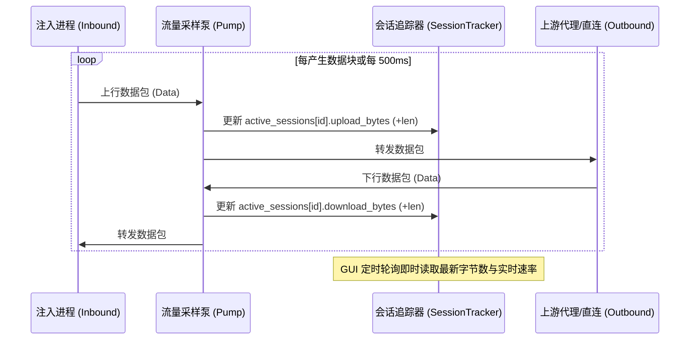
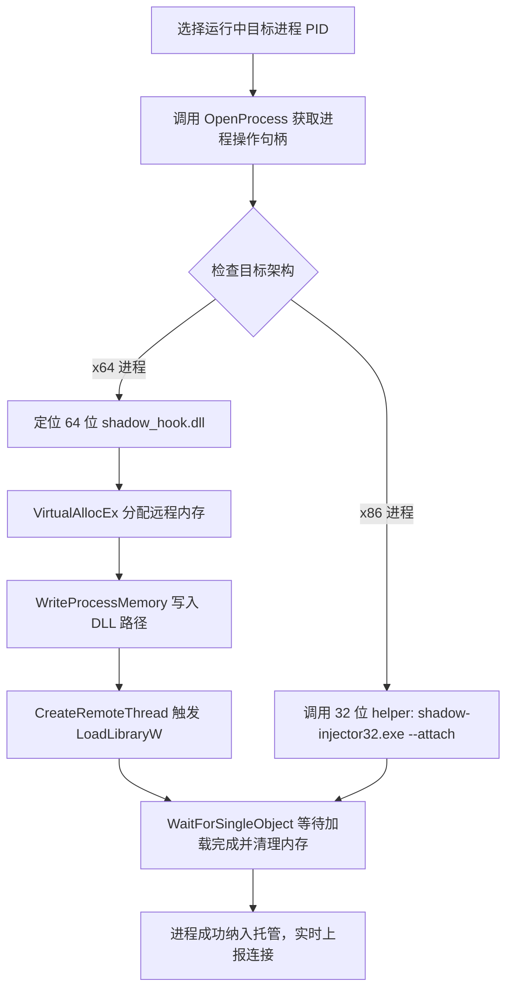
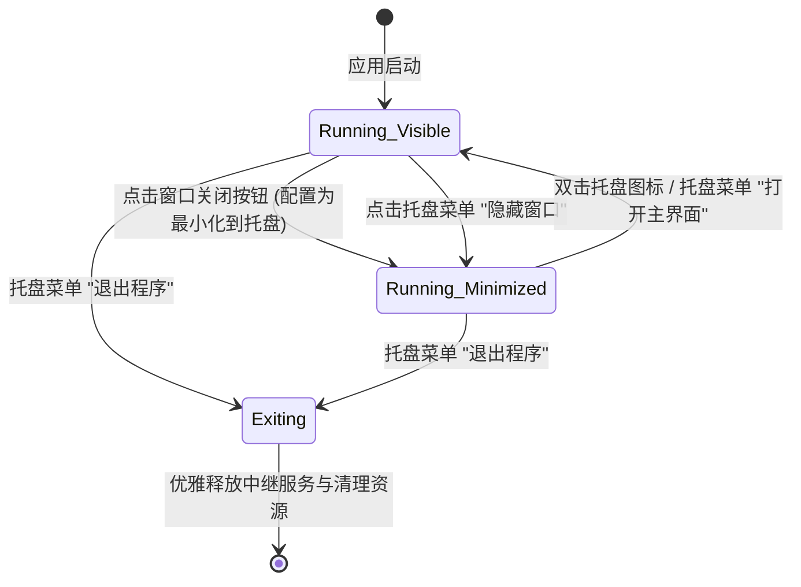

# ShadowProxy v0.2 现有功能深度优化迭代规划

> 面向人类导览见 [README.md](../../README.md)；通用元规则遵循全局规约。
> 本文档为 ShadowProxy v0.2 版本专项迭代设计与实施规约。

---

## 1. 迭代目标与愿景 (Vision & Principles)

### 1.1 核心目标
ShadowProxy v0.1.x 已完成核心透明中继、双架构注入、 Fake-IP 内存映射、DNS 严格防泄漏、上游健康感知、休眠自愈以及 GitHub 自动更新的基础链路闭环。
v0.2 版本的核心目标为**“聚焦现有功能深度优化”**，不引入不相关的新系统抽象（如虚拟网卡/TUN设备），而是对现有 6 个核心模块进行稳定性、可观测性、交互体验与性能瓶颈的精细打磨，达到工业级进程代理工具的标准。

### 1.2 核心原则
1. **零破坏性升级 (Backward Compatibility)**：网络帧协议与配置文件全面向前兼容 v0.1.x。
2. **零 Emoji 规范 (Zero-Emoji Policy)**：所有文档、代码注释、前端界面与日志严禁包含任何 Emoji。
3. **极简轻量 (Minimalist & Lean)**：以 Windows 原生 API 与标准库优先，不引入无必要的重型外部依赖。
4. **目标驱动与可验证性 (Goal-Driven & Testable)**：每个子项均具备明确的单元测试与集成测试验收标准。

---

## 2. 现有功能优化矩阵 (Optimization Matrix)

| 模块 | 现有实现 (v0.1.x) | 核心痛点与瓶颈 | v0.2 优化方案 | 预期收益 |
|---|---|---|---|---|
| **中继流量监控** (`shadow-core/relay`) | `copy_bidirectional` 阻塞执行，连接断开后才结算字节数 | 长连接（流媒体/下载/长轮询）在活跃期间上下行流量始终显示为 0 B | 引入带原子采样的双向流量泵，每 500ms 刷新活跃会话流量快照 | 实时连接看板动态呈现瞬时上下行流量与真实速率 |
| **中继帧协议** (`shadow-core/protocol`) | `GHST` 帧仅包含目标地址信息 | 中继服务无法感知连接由哪个进程发起，无法实现按进程统计与分流 | 升级为 v2 协议帧（携带发起端 PID 与进程名），并向下兼容 v1 | 支持显示连接发起程序，奠定按进程分流规则基础 |
| **上游代理支持** (`shadow-core/protocol`) | 仅支持 SOCKS5 代理协议 | 企业与内网环境下大量使用 HTTP CONNECT 代理，无法适配 | 协议层增加 HTTP CONNECT 隧道握手支持，上游配置自动探测协议 | 覆盖 SOCKS5 与 HTTP(S) 双主流上游代理协议 |
| **进程注入扩展** (`shadow-injector`) | 仅支持挂起冷启动 (`spawn_and_inject`) | 无法附加到已经在运行的目标程序（如已打开的浏览器/客户端） | 新增 `attach_process(pid)` 运行时动态挂钩注入接口 | 用户无需重启程序即可一键纳入透明代理管控 |
| **进程看板与管理** (`shadow-gui/view-procs`) | 仅展示由本程序主动派生的子进程树 | 缺少系统正在运行的进程列表视图，无法快速选择目标 | 进程看板增加系统进程快速浏览与一键“附加注入”列表 | 大幅降低配置与测试目标程序的操作门槛 |
| **分流路由引擎** (`shadow-core/router`) | 支持域名、IP-CIDR、端口 | 缺少“按发起进程名分流”能力（如指定仅让 `git.exe` 走代理） | 增加 `RulePattern::ProcessName` 匹配规则类型 | 实现“进程级”与“网络级”多维度精准分流策略 |
| **规则管理与备份** (`shadow-gui/view-rules`) | 仅支持图形化逐条录入与静态预设 | 无法批量备份、无法导入导出、无法拖拽调整优先级 | 增加规则 JSON 导入/导出、批量清空与拖拽排序功能 | 规则维护与跨设备迁移成本降为零 |
| **系统托盘与常驻** (`shadow-gui`) | 关闭窗口直接退出进程，无托盘图标 | 容易误关导致代理中断；无法作为后台守护静默运行 | 集成 Windows 原生系统托盘（Tray Icon），支持最小化与快捷菜单 | 支持后台静默运行与托盘快捷启停/退出 |
| **实时连接看板** (`shadow-gui/view-connections`) | 仅支持动作分类过滤，不支持实时搜索 | 捕获大量连接时排查诊断困难，历史无法一键清空 | 增加实时关键词搜索框、一键清空历史、会话日志导出 CSV | 诊断与故障排查体验提升 |
| **快捷预设管理** (`shadow-gui/view-presets`) | 仅记录可执行路径与运行参数 | 无法设置自定义备注别名，无法编辑已有条目 | 增加“别名备注”字段、行内编辑与按使用频次/时间智能排序 | 常用程序启动更加直观便捷 |
| **多架构构建工程** (`scripts/package.py`) | 需手动分别构建 32/64 位并搬运至 `bin/` | 发布操作步骤冗长，版本号容易产生同步疏漏 | 增加 `package.py --build` 全自动化编译与校验脚本 | 一键完成双架构编译、打包、签名检查与发布准备 |

---

## 3. 核心技术设计规范 (Technical Specifications)

### 3.1 本地中继帧协议 v2 规范 (Protocol Frame v2)

#### 帧格式定义
为兼容现有系统，在中继帧头部定义版本兼容标志：

```text
+----------------+--------+-----------+--------------------+---------------+-------------------+
| MAGIC (4B)     | VER(1B)| PID (4B)  | PROC_LEN + PROC(NB)| TARGET_TYPE(1)| TARGET_DATA...    |
+----------------+--------+-----------+--------------------+---------------+-------------------+
| "SHAD" / "GHST"|  0x02  | BigEndian | u8 len + UTF-8 str | 0x01/0x03/0x04| IPv4/Domain/IPv6  |
+----------------+--------+-----------+--------------------+---------------+-------------------+
```

- **兼容性回退**：若首字节匹配 `GHST` 且第 5 字节为 `0x01/0x03/0x04`，按 v1 协议解析（PID 标记为未知）。若第 5 字节为 `0x02`，则按 v2 协议解析。
- **开销控制**：进程名长度最大限制为 64 字节，仅提取文件名（如 `curl.exe`），不传输长路径，帧头总开销 ≤ 80 字节。

### 3.2 动态流量采样泵 (Monitored Stream Pump)

现有 `tokio::io::copy_bidirectional` 阻塞模式重构为非阻塞双向采样流：



### 3.3 运行时附加注入机制 (Attach to Running Process)

针对已运行进程的非侵入式注入工作流：



### 3.4 Windows 系统托盘状态机 (System Tray Lifecycle)



---

## 4. 实施里程碑与验证计划 (Milestones & Verification)

### 里程碑 1：核心协议与流量计费引擎优化 (Core Relay & Telemetry)
- [ ] 升级 `shadow-core/protocol` 实现中继帧协议 v2 与双向兼容解码。
- [ ] 在 `shadow-hook` 内部将当前进程 PID 及主进程名打入连接帧头。
- [ ] 在 `shadow-core/relay` 实现采样流量泵，活跃会话实时向 `SessionTracker` 报告累加字节。
- [ ] **验证点**：
  1. `cargo test -p shadow-core` 验证协议 v1 与 v2 编解码测试全部通过；
  2. 运行长连接测试（持续传输 5 秒），验证在连接未关闭状态下前端能够实时显示字节累加与瞬时速率。

### 里程碑 2：分流规则与多协议上游支持 (Routing & Protocols)
- [ ] 增加 `RulePattern::ProcessName(String)`，支持根据连接发起程序分流。
- [ ] 在 `protocol.rs` 增加 HTTP `CONNECT` 代理协议支持，支持 `http://` 与 `socks5://` 自动适配。
- [ ] 在 `router.rs` 与前端界面实现规则 JSON 导入/导出与排序。
- [ ] **验证点**：
  1. 单元测试覆盖 `ProcessName` 匹配与 HTTP `CONNECT` 握手报文解析；
  2. 配置 `git.exe -> PROXY, curl.exe -> DIRECT` 规则，使用 curl 验证命中直连，使用 git 验证命中代理。

### 里程碑 3：运行时附加注入与进程管理 (Runtime Attach & Supervisor)
- [ ] 在 `shadow-injector` 实现 `attach_process(pid: u32)` 运行时动态注入。
- [ ] 32 位专用辅助程序 `shadow-injector32` 支持 `--attach <PID>` 模式。
- [ ] 在 GUI “进程看板”增加系统运行中进程列表，提供一键“附加代理”功能。
- [ ] **验证点**：
  1. 预先启动一个记事本或测试进程，点击“附加代理”，验证 DLL 成功挂载且该进程网络流量被捕获。

### 里程碑 4：桌面交互与托盘常驻增强 (UI, Tray & Presets)
- [ ] 集成 Windows 系统托盘图标（Tray Icon），支持最小化常驻与右键菜单（启停中继/显示/退出）。
- [ ] “实时连接”视口增加即时关键词搜索筛选框与一键清空记录功能。
- [ ] “常用快捷”视口增加别名备注字段与行内快捷编辑。
- [ ] **验证点**：
  1. 关闭窗口后程序仍在后台托盘运行，双击托盘图标重新激活窗口；
  2. 连接看板输入关键词即时过滤，清空按钮工作正常。

### 里程碑 5：自动化构建与工程交付 (Build & CI Pipeline)
- [ ] 完善 `package.py --build` 命令，自动依次构建 x86_64 与 i686 目标，归档至 `bin/` 并生成安装包。
- [ ] 更新 GitHub Actions CI 脚本，支持在 Tag 触发时全自动构建双架构发行物。
- [ ] 更新项目文档与操作指南。
- [ ] **验证点**：
  1. 执行单一命令完成从纯源码到双架构独立安装包的完整打包与 SHA256 清单输出。

---

## 5. 验收标准与交付检查表 (Checklist)

- [ ] **构建无警告**：`cargo check --workspace --all-targets` 零警告，零错误。
- [ ] **测试全通过**：`cargo test --workspace` 全量测试套件通过。
- [ ] **零 Emoji**：全量代码、注释、提交信息与文档 100% 无任何 Emoji。
- [ ] **单一事实源**：版本号与依赖声明与根目录 `Cargo.toml` 严格同步。
